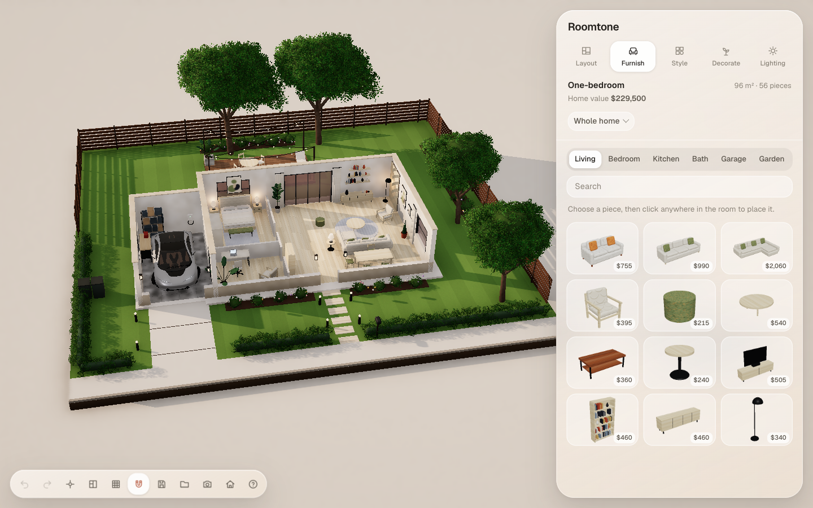

# Roomtone

Build a home, room by room. Roomtone is a Sims-style build and buy game that runs in your browser: draw rooms on an empty lot, add doors and windows, design the garden, furnish every room, pick finishes, add an upstairs, and watch it all from sunrise to night.

**Play it:** https://madebysourasith-sudo.github.io/roomtone/

## What you can do

- Start from an empty lot or one of five ready-made plans
- Draw rooms on a grid, then push walls and move rooms
- Add doors, windows, glass doors and a garage door
- Design the garden: pool, deck, paving, flower beds, fences and hedges
- Furnish with 60+ pieces, including kitchen counters you can make longer
- Wallpaper, tile, brick, timber and paint for floors, walls and the outside
- Add a second floor with stairs, then put the roof on
- Change the time of day, from morning to night with glowing windows
- Save several homes in your browser and come back to them

## Controls

- **Click a piece** in the panel, then click in the room to place it. **R** turns it, **Esc** cancels.
- **Drag** a placed piece to move it; pull the round handle to turn it.
- **Right-drag** turns the view, **scroll** zooms, **⌘Z / ⇧⌘Z** undo and redo.
- **Double-click a floor** to look at one room on its own.

Works best in a recent desktop Chrome, Edge, Safari or Firefox. It needs WebGL and an internet connection (three.js and fonts load from public CDNs).

## Credits

- Inspired by Ryan Sael's "Set the Mood" interior moodboard.
- Car model: [Car Concept](https://github.com/KhronosGroup/glTF-Sample-Assets/tree/main/Models/CarConcept) by the Khronos Group, CC BY 4.0.
- Built with [three.js](https://threejs.org) and [N8AO](https://github.com/N8python/n8ao).
